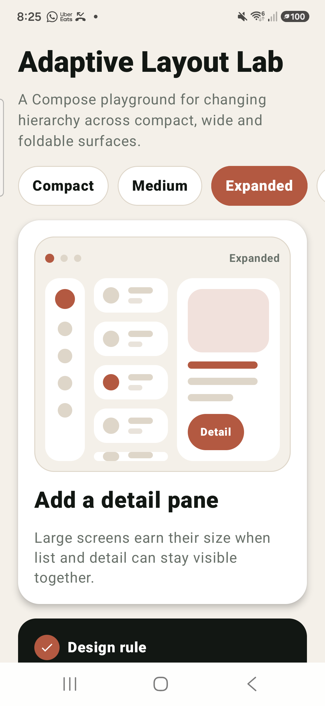

> **Ce lab a déménagé.** Il fait maintenant partie de [mobile-ui-labs](https://github.com/YANKAMKEVIN/mobile-ui-labs), qui réunit les 10 labs dans une seule app. Ce dépôt est archivé.

# Adaptive Layout Lab

Mini-projet Android/KMP pour explorer les decisions de layout adaptatif dans une UI Compose.

Le but n'est pas de livrer une app complete, mais de montrer comment une experience peut changer de structure selon le contexte :

- compact avec bottom navigation ;
- medium avec navigation rail ;
- expanded avec liste + detail ;
- foldable avec separation physique ;
- density avec une surface plus efficace.

## Pourquoi ce mini-projet ?

Un layout responsive n'est pas seulement une grille qui s'etire. C'est une decision produit :

- quelle information reste prioritaire sur petit ecran ?
- quand faut-il passer d'une navigation basse a une navigation laterale ?
- comment eviter qu'un grand ecran devienne juste une version vide du mobile ?
- comment une UI garde-t-elle son rythme quand la densite change ?

Le lab est interactif pour comparer rapidement les breakpoints et les arbitrages de hierarchie.

## Stack

- Kotlin Multiplatform
- Compose Multiplatform
- Material 3
- Android target pret a lancer

## Screenshots

<p align="center">
  
</p>

## Idee de post LinkedIn

> Un layout adaptatif, ce n'est pas "faire rentrer plus de contenu".
>
> Dans ce mini-projet Compose/KMP, j'explore comment une meme experience change entre compact, medium, expanded, foldable et dense mode.
>
> La vraie question : a quel moment le layout doit-il changer la hierarchie, pas seulement la taille ?

## Run

```bash
./gradlew :composeApp:assembleDebug
```
